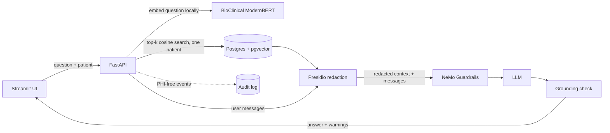

# Secure EHR Insight – Clinical Validator

[](https://github.com/GayathriSangaraju/Secure-EHR-Insight-Clinical-Validator/actions/workflows/ci.yml)

A zero-trust RAG demo for querying electronic health records. A clinician picks a patient and asks
a question in chat. The system retrieves that patient's records, strips PHI, runs the request
through guardrails, and checks the answer against the records before returning it.

> **Not for clinical use.** This is a demonstration project. It is not a medical device, and its
> output must not inform diagnosis or treatment.

## How it works



1. **Retrieve.** The question is embedded locally and matched against the selected patient's rows
   with pgvector. Queries are always scoped to one `subject_id`.
2. **Redact.** Retrieved records *and* the user's messages go through Microsoft Presidio (names,
   phones, emails, SSNs, dates, locations, organisations) before anything reaches the LLM.
3. **Guard.** NeMo Guardrails blocks requests for medical advice, prompt-injection attempts and
   cross-patient requests.
4. **Check.** Numeric figures (doses, lab values) in the answer must appear in the retrieved
   records, otherwise the response is flagged `grounded: false` with a warning.
5. **Audit.** Each request logs a JSON event with a pseudonymised patient reference, counts and
   outcome, and never the question, records or answer.

## Quick start (Docker)

```bash
cp .env.example .env            # set DB_NAME, DB_USER, DB_PASSWORD, OPENAI_API_KEY, AUDIT_HASH_KEY
export COMPOSE_FILE=deploy/local/docker-compose.yml COMPOSE_ENV_FILES=.env   # Compose 2.24+

docker compose up --build -d    # Postgres+pgvector, migrations, API (:8000), UI (:8501)
# load the synthetic sample (no MIMIC access needed), then generate embeddings
docker compose run --rm api python scripts/ingest_baseline_data.py --csv data/sample/synthetic_encounters.csv
docker compose run --rm api python scripts/generate_embeddings.py --limit 100
```

Open http://localhost:8501. The first start downloads the embedding model and spaCy model.

## Local development

Requires Python 3.10+ (CI covers 3.10 and 3.12; it also installs on 3.13), PostgreSQL with the
`pgvector` extension, and an OpenAI API key. Full local and Docker instructions: `deploy/local/README.md`.
Using a database on EC2 instead? See `deploy/ec2/README.md`.
Run every command below from the repository root, since the guardrails config is loaded
from `./src/guardrails`.

```bash
# 1. Python environment
python3 -m venv .venv && source .venv/bin/activate
pip install -e ".[ml,pii,data,ui,dev]"
python -m spacy download en_core_web_lg

# 2. Configuration: set DB_PASSWORD, OPENAI_API_KEY and AUDIT_HASH_KEY
cp .env.example .env

# 3. Database: either use your own Postgres+pgvector, or start just the DB container
#    (uses DB_USER / DB_PASSWORD / DB_NAME from .env, listens on 127.0.0.1:5432)
docker compose -f deploy/local/docker-compose.yml --env-file .env up -d db

# 4. Schema and data (sample data shown; see data/README.md for MIMIC-IV)
python scripts/migrate.py
python scripts/ingest_baseline_data.py --csv data/sample/synthetic_encounters.csv
python scripts/generate_embeddings.py
python scripts/verify_ingestion.py        # optional sanity check

# 5. Run the app (two terminals, both with the venv activated)
uvicorn src.api.main:app --reload         # API on http://localhost:8000
streamlit run src/ui/app.py               # UI  on http://localhost:8501

# 6. Lint and test
ruff check . && ruff format --check .
pytest
```

The first API start downloads the embedding model, so give it a minute before the UI can
list patients. Check readiness with `curl http://localhost:8000/health`.

## Data

This repository contains **no real patient data**. For the full dataset you need credentialed
access to [MIMIC-IV](https://physionet.org/content/mimiciv/) under the PhysioNet data use agreement
(see `data/README.md`). Without it, use the fabricated sample in `data/sample/`.

## Configuration

All settings are environment variables; see `.env.example`.

| Variable | Purpose | Default |
| --- | --- | --- |
| `DB_HOST` `DB_PORT` `DB_NAME` `DB_USER` `DB_PASSWORD` | Postgres connection (or `POSTGRES_URL`) | required |
| `OPENAI_API_KEY` | LLM used by NeMo Guardrails | required for chat |
| `AUDIT_HASH_KEY` | Secret for pseudonymising patient IDs in audit logs | empty (set one) |
| `EMBEDDING_MODEL` | Sentence-transformers model (768-dim) | `NeuML/bioclinical-modernbert-base-embeddings` |
| `RETRIEVAL_TOP_K` | Records retrieved per question | `5` |
| `REDACTION_ENTITIES` / `REDACTION_DENY_LIST` / `REDACTION_SCORE_THRESHOLD` | Presidio behaviour | see `src/config.py` |

## Project layout

```
src/api/            FastAPI app (lifespan-loaded models, /api/v1/chat, /health)
src/pii_redaction/  Presidio wrapper
src/guardrails/     NeMo config + Colang rails
src/output_checks.py  deterministic answer checks (grounding)
src/database/       engine + SQL migrations (001_init, 002_embeddings) and runner
src/audit.py        PHI-safe audit events
src/ui/             Streamlit chat UI
deploy/local/       Docker stack (db, migrate, api, ui) + local-development guide
deploy/ec2/         guide for a database hosted on EC2 (SSH, credentials, tunnel)
scripts/            migrate, ingest, embed, verify, manual smoke checks
tests/              pytest suite
data/               local data only (git-ignored) + synthetic sample
```

## Testing and CI

`pytest` runs the suite. Unit tests need no ML libraries; API tests replace the model, redactor
and database with fakes; redaction tests run real Presidio when the spaCy model is installed.
GitHub Actions runs ruff, pytest on Python 3.10 and 3.12, a guard that fails if data files are
tracked, and gitleaks. Install the hooks with `pre-commit install`.

## Limitations

This is a portfolio/demo project. Known gaps, deliberately out of scope for now:

- **No authentication or per-user authorization.** Anyone who can reach the API can query any patient.
- **Error responses are not sanitised**, and there is no rate limiting.
- **Redaction is statistical** (NER + patterns) and can miss identifiers; dates are redacted
  aggressively, which can remove clinically useful detail.
- **The grounding check is lexical.** It catches invented figures, not wrong reasoning.
- Dependencies use lower bounds rather than a lockfile.

## License

MIT, see `LICENSE`.
